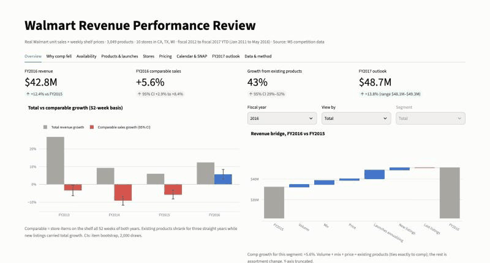
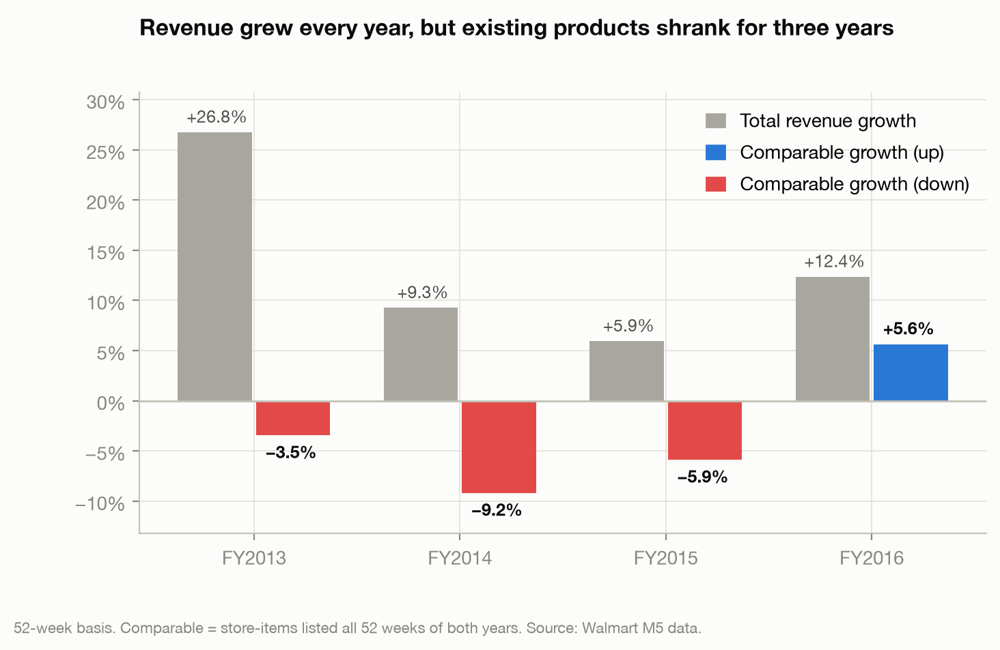

# Walmart Revenue Performance Review

**Revenue across 10 Walmart stores grew 65% in four years, but the same products in the same stores sold less for three of those years.** This project measures how much growth was real, finds why existing products shrank, sizes the levers (availability, pricing, SNAP timing, store changes), groups products into five segments with their own playbooks, designs a price test, and forecasts the next year. It uses real Walmart sales data.

 · 📄 [Executive summary](reports/executive_summary.md) · 📓 [Exploration notebook](notebooks/01_exploration.ipynb) · 🎤 [Interview Q&A](docs/interview_prep.md) · 📊 Dashboard: `streamlit run app.py --server.address localhost` <!-- add the deployed link: docs/deploy.md -->

## Start here (2 minutes)
1. **The question:** total revenue is growing. Is that real, and what should the business do next?
2. **The answer:** growth came mostly from *adding* products. Existing products shrank for three years, mainly from weaker demand, and recovered in FY2016. Stock-outs, SNAP timing and a carefully designed price test are where the money is.
3. **Where to look:** the [executive summary](reports/executive_summary.md) (one page), the dashboard below, then the [SQL highlights](#sql-highlights) and [methods](#whats-in-the-analysis).



## Four findings

**1. Less than half of growth was organic.** Comparable sales (same products, same stores, a full year in both years) fell **−3.5%, −9.2%, −5.9%** in FY2013–15 while total revenue rose, then grew **+5.6%** in FY2016 (95% CI +2.9% to +8.4%). Only **43%** of FY2016's +$4.7M came from existing products; the rest was new products.

**2. The decline was weak demand, not cannibalization or pricing.** Departments that added more products held up *better*. Old and new products fell together. Stock-outs explain about 2 points of FY2014's −9.2%. Walmart held food prices 1.4–1.7 points *below* food inflation (BLS CPI) while volume still fell, and raised them 0.7 points *above* it in FY2016 as sales recovered. The timing matches Walmart's weakest reported year (U.S. comps −0.6% in FY2014).

**3. The levers are measurable.**
- **Stock-outs:** about **$0.8M** of revenue lost per year since FY2014.
- **Price sensitivity:** Household looks least price-sensitive in the main model (elasticity about **−0.4**), but the robustness checks are noisy, so it needs a test before any rollout.
- **Temporary price cuts:** rare under Walmart's everyday-low-price model, about $20K of discount a year with no clear unit lift. Not a priority.
- **SNAP days:** food revenue lifts **+9% to +28%**, depending on the state.
- **FY2017:** tracking to **$48.7M (+13.8%)**, where a naive run-rate would likely overstate it by about $1.3M.

**4. Five product segments need five different playbooks.** Grouping all 3,049 products by how they sell (speed, gaps, seasonality, SNAP lift, stock-outs) gives **core fast movers** (27% of products, 46% of revenue), **SNAP-driven staples**, **availability risk**, **seasonal** and **long tail**. The surprise: **SNAP-driven staples are 14% of products but 41% of store stock-out losses.** Food runs out around SNAP days.



## Recommendations
| Action | Evidence | First step |
|---|---|---|
| Report comparable sales next to total growth | Total growth hid three years of decline | Add comp + revenue bridge to the monthly review |
| Test a **5%** Household price increase | Main model says ≈ −0.4, but checks are noisy; worth ≈ $0.4M a year if −0.4 holds | Randomize half of product-store pairs for 12 weeks (89% power; [design](src/retailrev/experiment_design.py)) |
| Cut store stock-outs, starting with SNAP-driven staples | $0.79M lost in FY2016; 41% of it in SNAP-driven staples | Daily zero-sales alerts; extra stock ahead of SNAP days |
| Review chain-wide gaps with merchandising | $2.1M lost in FY2016 while listed products were dark in most stores at once | Separate deliberate range cuts from supply failures |
| Plan food stock and labor to the SNAP calendar | Food +9% to +28% on SNAP days, sagging to −19% by month-end in Wisconsin (−27% on the 1st) | Shift replenishment into SNAP windows |

## What's in the analysis

| Question | Method, in plain English (technical name) | Result |
|---|---|---|
| How much growth is real? | Compare only products on the shelf all year in both years, then split the change into volume, mix and price, checked to the cent (comparable sales, PVM bridge, bootstrap CIs) | 43% of FY2016 growth organic |
| Why did existing products shrink? | Test each explanation against the data: did departments that added more products do worse? did old products fade? (fixed-effects panel with a placebo, launch cohorts, availability decomposition, BLS CPI) | Not cannibalization or pricing; mostly demand |
| How much is lost to stock-outs? | Flag runs of zero-sale days that a product's own sales history makes less than 0.1% likely (empirical run probability) | $0.79M store stock-outs (FY2016) |
| How price-sensitive is demand? | Compare the store that changed a price with stores that didn't, for the same product in the same weeks (Poisson fixed effects, stacked difference-in-differences) | Household ≈ −0.4 (main model); increases −0.51, cuts −3.17 |
| How should we test a price change? | Run hundreds of fake tests on real history where nothing changed, to measure the true noise (A/A simulation, power analysis) | Product-store randomization: 89% vs 25% power |
| Which products behave alike? | Group products by five sales behaviours and check the groups are stable (k-means, silhouette, adjusted Rand) | 5 segments; SNAP staples hold 41% of stock-out losses |
| What do SNAP days and holidays do? | Compare SNAP days with other days in the same store and month (fixed-effects models) | Food follows the SNAP calendar day by day |
| Which store changes were real? | Find the week each store's sales jumped, then compare it with a "twin" built from stores that didn't (changepoint detection, synthetic control, placebo tests) | +83%, +52%, +42%, −25% |
| Where will FY2017 land? | Try four forecasting methods on past years and keep the most accurate (backtesting) | $48.7M, 0.9% average backtest error |

## SQL highlights
All business metrics are plain SQL files in [`sql/metrics/`](sql/metrics), run on a DuckDB warehouse of 59M daily rows.

**Comparable sales** ([comp_sales.sql](sql/metrics/comp_sales.sql)): a store-item counts only if it had a shelf price in all 52 weeks of *both* years, so new products can't inflate growth.
```sql
full_year AS (          -- store-items listed every week of a fiscal year
    SELECT store_id, item_id, fiscal_year, sum(revenue) AS revenue
    FROM weekly
    GROUP BY ALL
    HAVING count(*) = 52
),
pairs AS (
    SELECT cur.fiscal_year,
           sum(prev.revenue) AS comp_revenue_prior,
           sum(cur.revenue)  AS comp_revenue_current
    FROM full_year cur
    JOIN full_year prev
      ON prev.store_id = cur.store_id AND prev.item_id = cur.item_id
     AND prev.fiscal_year = cur.fiscal_year - 1
    GROUP BY cur.fiscal_year
)
```

**Revenue bridge** ([pvm_bridge.sql](sql/metrics/pvm_bridge.sql)): splits the year-over-year change into volume, mix and price for existing products, plus launches and new or lost listings. The pieces add back to the total exactly, at any level (chain, store, category).
```sql
(c.Q1 - c.Q0) * (c.R0c / c.Q0)   AS volume_effect,   -- more units at last year's average price
c.q1p0 - c.Q1 * (c.R0c / c.Q0)   AS mix_effect,      -- shift toward pricier or cheaper items
c.R1c - c.q1p0                   AS price_effect,    -- same items at different prices
```

**Stock-out detection** ([03_stockouts.sql](sql/03_stockouts.sql)): window functions give each zero-sale run the product's own sales history in the 28 days before and after, which sets how unlikely the run is.
```sql
sum(CASE WHEN units > 0 THEN 1 ELSE 0 END)
    OVER (PARTITION BY store_id, item_id ORDER BY date) AS block,        -- groups each zero-sale run
avg(units) OVER (PARTITION BY store_id, item_id ORDER BY date
                 ROWS BETWEEN 28 PRECEDING AND 1 PRECEDING) AS rate_before,
sum(CASE WHEN units = 0 THEN 1 ELSE 0 END) OVER (PARTITION BY store_id, item_id ORDER BY date
                 ROWS BETWEEN 1 FOLLOWING AND 28 FOLLOWING) AS zeros_after
```

The same warehouse is rebuilt in [dbt](dbt/) with 34 data tests, including one that checks dbt's numbers against the Python pipeline.

## Engineering
- **SQL warehouse in DuckDB:** 59M daily rows, plus a parallel **dbt** project with 34 data tests.
- **27 pytest tests:** each method must recover a known answer from simulated data (elasticity −1.2, a +40% store step, a planted stock-out, five planted product segments), every revenue bridge must reconcile, and randomized steps must give identical results whatever order the data arrives in.
- **Reproducible:** the full pipeline was re-run and every output diffed against the previous run; exact package versions are pinned in `requirements-lock.txt`.
- **GitHub Actions:** linting with ruff, the tests, and a dbt compile check, on the pinned versions. Tests that need the non-redistributable raw data skip in CI.
- **Self-contained dashboard:** it reads only the committed `outputs/`, so it deploys without the raw data ([deploy guide](docs/deploy.md)).
- **BI-ready:** extracts and build guides for [Tableau](docs/tableau_build_guide.md) and [Power BI](docs/powerbi_build_guide.md).

## Data and limits
[M5 Forecasting competition](https://www.kaggle.com/competitions/m5-forecasting-accuracy/data): **real Walmart** daily unit sales and weekly shelf prices for 3,049 products in 10 stores (CA, TX, WI), Jan 2011 – May 2016. The data is described in Makridakis, Spiliotis & Assimakopoulos, *International Journal of Forecasting* 38(4), 2022. Inflation data is BLS CPI-U (public domain). The raw data isn't redistributable, so it isn't in this repo.

- **Sample:** product names are anonymized, and this is a sample, not all of Walmart.
- **Survivorship:** only products still sold in 2016 are included. Comparable sales are built to be robust to this.
- **No promotion or display data:** price cuts may carry "Rollback" signage effects.
- **Unknown causes:** store step changes are measured, but what caused them isn't in the data.
- **SNAP:** the analysis shows *when* food spending happens, not whether it's net new.
- **Stock-outs:** detection is statistical; there are no inventory records to confirm it.
- **Segments:** they group a continuum (silhouette about 0.2), so they're useful working groups rather than sharply separate types.

## Reproduce
```bash
python3.14 -m venv .venv && source .venv/bin/activate
pip install -r requirements-lock.txt && pip install -e .   # exact versions (Python 3.14)
# download from Kaggle (accept the competition rules) and unzip into data/raw/
python -m retailrev.build        # DuckDB warehouse incl. stock-out detection (~30 s)
python -m retailrev.pipeline     # every analysis -> outputs/ (~5 min)
python -m retailrev.figures      # report charts
python -m retailrev.figures --deck   # slide-sized versions (uses Inter from assets/fonts/ if present)
python -m retailrev.tableau      # Tableau / Power BI extracts
pytest                           # 27 tests
cd dbt && dbt build --profiles-dir .   # 34 dbt data tests
streamlit run app.py --server.address localhost   # local only; drop the flag to share on your network
```

## Repository
```
sql/            warehouse build (staging, marts, stock-out detection) + one file per business metric
dbt/            the same warehouse as dbt models with schema and reconciliation tests
src/retailrev/  pipeline and analyses: drivers, stockouts, pricing, price_events, experiment_design,
                segments, inflation, events, launches, store_events, outlook, robustness, figures
notebooks/      exploratory analysis with a findings log
outputs/        every result as CSV (+ tableau/ extracts, also used for Power BI)
reports/        executive summary, 17 figures, dashboard GIF
docs/           interview Q&A, Tableau and Power BI build guides, deploy guide
app.py          Streamlit dashboard (10 tabs)
tests/          method tests on simulated data + output-integrity tests
```

## License
Code: [MIT](LICENSE). Data: not included; see the M5 competition terms.
