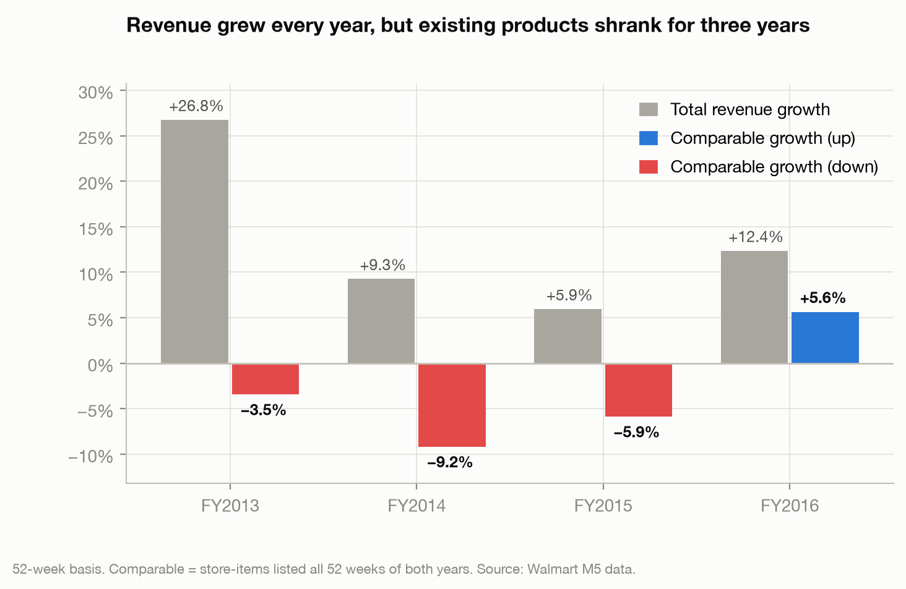
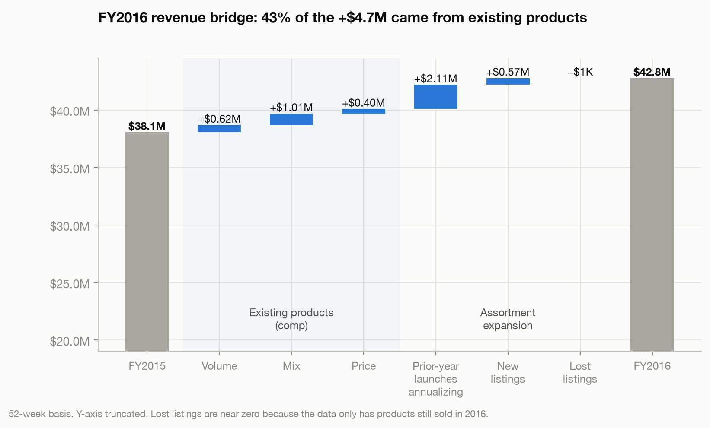
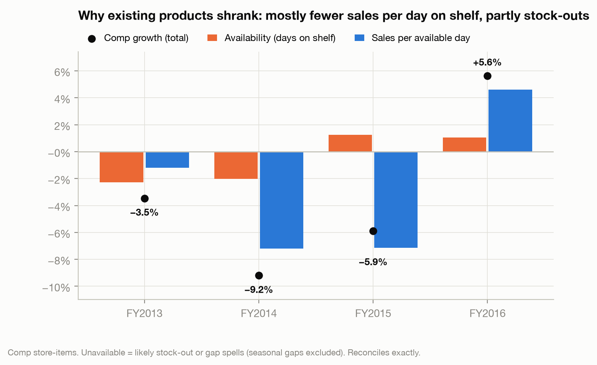
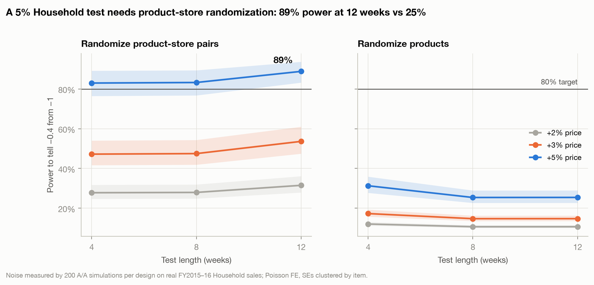
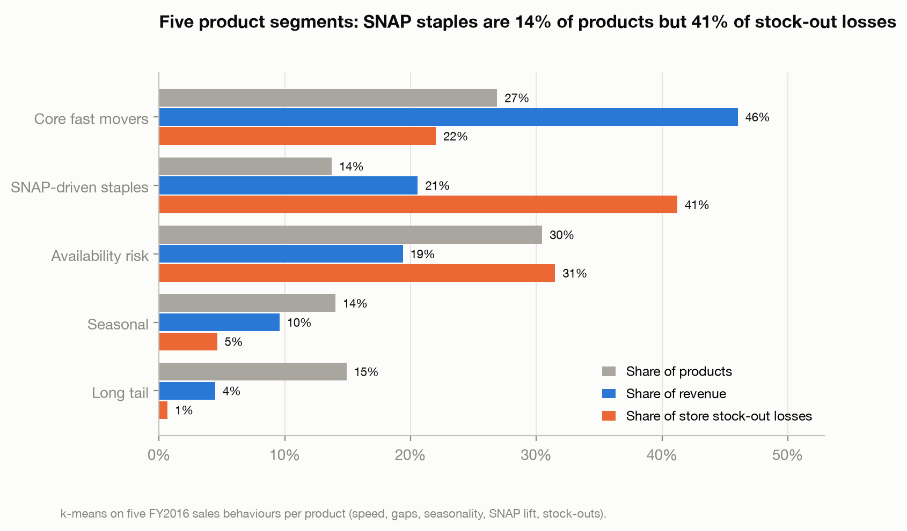
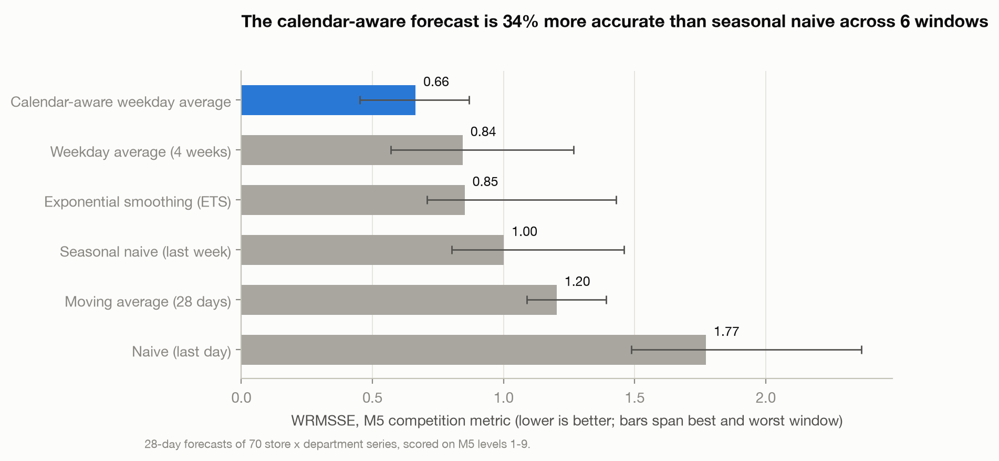

# Walmart Revenue Performance Review: Executive Summary

**Scope:** 10 Walmart stores in California, Texas and Wisconsin · 3,049 products · fiscal 2012 – fiscal 2017 YTD (Jan 2011 – May 2016) · real unit sales × weekly shelf prices (M5 data) · inflation from BLS CPI

## Bottom line
Revenue grew **65%** from FY2012 to FY2016 ($25.9M → $42.8M), but **the same products in the same stores sold less for three straight years**. Comparable sales were −3.5%, −9.2% and −5.9%. Adding products carried growth until FY2016, when comparable sales turned positive (**+5.6%**, 95% CI +2.9% to +8.4%). FY2017 is tracking to **$48.7M (+13.8%)**.

## What to do
1. **Report comparable sales next to total growth** in every review, with the revenue bridge.
2. **Run the Household price test** as set out in the [brief](../docs/price_test_brief.md): a 5% increase on a random half of product-store pairs for 12 weeks. If elasticity is about −0.4, a full Household rollout is worth about **+3% ≈ $0.4M a year** on $13.3M of revenue. If the test finds elasticity near −1, don't roll out.
3. **Cut store stock-outs**, starting with SNAP-driven staples (41% of the losses): daily zero-sales alerts (a prototype is built; validate it against shelf checks), modestly more safety stock and SNAP-aware ordering for staples. $0.79M was lost in FY2016; about $0.2M a year is realistically recoverable.
4. **Plan food replenishment and labor to each state's SNAP calendar**, especially in Wisconsin and Texas.
5. **Review chain-wide gaps with merchandising:** $2.1M of FY2016 revenue was lost while listed products were dark in most stores at once. Separate deliberate range cuts from supply failures.
6. **Visit CA_3** (the largest store, with flat comparable sales) **and WI_3** (−25% in April 2013).

The evidence for each is below.

## Findings

**1. Less than half of FY2016 growth was organic.** Of the +$4.7M increase, **43%** (95% CI 29–52%) came from existing products: volume +$0.62M, mix +$1.01M, price +$0.40M. The rest came from last year's launches reaching a full year (+$2.1M) and new listings (+$0.6M). The bridge reconciles to the cent for every year, store and category.

**2. Existing products shrank because of weak demand, not cannibalization or pricing.** Each explanation was tested directly:
- **Cannibalization: ruled out.** Store-departments that added more new products held up *better*. A placebo test (products added in other departments) shows the same.
- **Product ageing: ruled out.** Products from every launch year declined together in FY2014–15, then recovered together.
- **Availability: partial.** Fewer days on the shelf explain 2.0 of the 9.2-point FY2014 decline. The other 7.2 points came from lower sales per available day.
- **Pricing: ruled out.** Walmart held food prices 1.4–1.7 points *below* food-at-home inflation (BLS CPI) in FY2014–15, yet volume still fell. In FY2016 it priced 0.7 points *above* inflation, and comparable sales recovered anyway.
- **Timing:** same-item food sales turned negative in Oct 2012 and recovered in Apr 2014. That matches Walmart's weakest reported year (U.S. comparable sales −0.6% in FY2014).

**3. Stock-outs have cost about $0.8M a year since FY2014.** A zero-sale run is flagged when the product's own sales history makes it less than 0.1% likely.
- **Store stock-outs:** $0.79M lost in FY2016 (1.9% of revenue).
- **Chain-wide gaps:** another $2.1M, when products are dark in most stores at once. That's a supply or assortment question.
- **Store long gaps:** $0.46M, when one store is dark for longer than 28 days while most other stores keep selling.
- **Seasonal gaps:** $1.6M, which are intentional.

**4. Household is the best candidate for a price test, but not a settled case.** In the main Poisson fixed-effects model, Household elasticity is about −0.4 (HOUSEHOLD_1 −0.41, HOUSEHOLD_2 −0.39), while Foods sits near −0.9 to −1.4. The robustness checks are noisier: restricted to fast sellers, HOUSEHOLD_2 comes out at +0.09 (CI −0.57 to +0.75), and the price-change event study for HOUSEHOLD_1 alone gives −1.63 (CI −2.88 to −0.38). That uncertainty is why the recommendation is a test, not a rollout. Across all 15,246 permanent price changes, compared against the same product in stores that kept the old price:
- **Increases cost few units:** elasticity −0.51 (CI −0.89 to −0.14).
- **Cuts gained a lot:** elasticity −3.17, likely boosted by "Rollback" signage that isn't in the data.
- **Temporary cuts barely matter:** around −30% cuts lifted units +4.5%, which is not statistically significant (CI −0.4% to +9.8%). Under everyday low pricing they are also rare: the 916 identified in FY2016 gave away about $7K of discount, and a broad screen of every short price dip finds about $20K (0.05% of revenue).

**5. The price test must be designed carefully.** Simulations on real history ("A/A tests") show that a 2% test, or a test that randomizes whole products, has only **11–32% power** to tell −0.4 from −1. **Randomizing product-store pairs with a 5% increase for 12 weeks gives 89% power** (95% CI 83–94%).

**6. SNAP benefit days drive food demand.** Food revenue rises **+9% (CA), +18% (TX), +28% (WI)** on SNAP days, while non-food moves about 2%. Food spending relative to household follows each state's SNAP calendar day by day, then sags toward month-end: down to −4% in California, −11% in Texas and −19% in Wisconsin, where the low point is the 1st of the month (−27%), the day before its SNAP days begin.

**7. Four stores changed step.** Synthetic controls (each store compared with a weighted "twin" built from stores without a change) show three food-led step-ups: WI_2 **+83%**, CA_2 **+52%**, WI_1 **+42%**. WI_3 dropped **−25%** across every category in April 2013. Each effect is larger than all placebo stores.

**8. FY2017 outlook: $48.7M (range $48.1–49.3M).** The method projects each store from its own trend but stops CA_2's one-time jump from compounding after its anniversary. It won a backtest across three years (average full-year error 0.9%). A naive chain run-rate would say $50.0M, likely about $1.3M too high (its own range, $48.2–51.9M, is wide).

**9. Five product segments need different playbooks.** Clustering all 3,049 products on five sales behaviours (speed, share of weeks with no sales, seasonality, SNAP-day lift, stock-out losses) gives five stable groups (products land in the same group 81% of the time across random restarts):

| Segment | Products | Revenue | Store stock-out losses | Playbook |
|---|---|---|---|---|
| Core fast movers | 27% | 46% | 22% | Protect: daily replenishment, close price watch |
| SNAP-driven staples | 14% | 21% | **41%** | Build stock and staff ahead of SNAP days |
| Availability risk | 30% | 19% | 31% | Zero-sales alerts, more safety stock |
| Seasonal | 14% | 10% | 5% | Buy to the season; sales shrinking 10% |
| Long tail | 15% | 4% | 1% | Range review |

SNAP-driven staples carry far more than their share of stock-outs: demand spikes on SNAP days and shelves run dry.

**10. Stress-testing sharpened the recommendations.**
- **Forecasting:** scored with the M5 competition's own metric (WRMSSE, 9 aggregate levels, six 28-day windows), a weekday average that adds the SNAP-day effects from finding 6 is **34% more accurate than seasonal naive** and 22% better than exponential smoothing, winning 5 of 6 windows.
- **Stock-outs:** a weekly-ordering simulation, calibrated so today's policy loses what the detector measured, recovers **26% of losses for $85K more average inventory** (+0.5 SD safety stock), with diminishing returns after that. Scaled to all store stock-outs, about **$0.2M a year is realistically recoverable**, not $0.79M. SNAP-aware ordering saves staples about $17K a year at the same inventory.
- **Alerts:** a prototype daily zero-sales alert judges each product against its own recent sales, at most 5 per store per day; items dark in 4+ other stores or for over 28 days go to merchandising. Using only data available each morning of FY2016, **61%** of alerts were later confirmed as gaps by the full detector (**43%** as store stock-outs), with **48% of store stock-out loss still ahead**; those stock-outs lasted a median 4 more days. The detector uses nearly the same test, so this is agreement, not proof. An independent test planted known stock-outs in later sales: at equal alert volume the alert catches **36% of 7-day gaps** (3% for a fixed-day rule) and 62% of 14-day gaps (13%), but only 9% of 3-day gaps. The fixed rule must wait about 20 days to stay at that volume, which is why it catches so little; a 5-day rule catches every 7-day gap but at about 85 alerts per store per day. The [pilot plan](../docs/stockout_alert_brief.md) checks shelves before any rollout.
- **Launches:** first-month revenue per store-week alone ranks future top sellers with AUC 0.92; its top-20% picks become top sellers 71% of the time (19% at random). A logistic model with five more signals adds nothing.
- **Price test:** the [experiment brief](../docs/price_test_brief.md) fixes the analysis in advance. Run on real sales with a planted response, the decision rule rolled out 82% of the time when the rise truly pays (consistent with the designed 89%) and never when it doesn't; estimates were unbiased.

## Caveats
- **A sample, not all of Walmart:** 3,049 anonymized products in 10 stores, not total store revenue.
- **Survivorship:** M5 includes only products still sold in 2016. Comparable sales are robust to this; total growth is not.
- **No promotion or display data:** price-cut effects may include signage.
- **Statistical stock-out detection:** there are no inventory records to confirm it.
- **Segments group a continuum:** silhouette is about 0.2, so they are useful working groups rather than sharply separate types.
- **Unknown causes:** store step changes are measured, but their causes are not in the data.
- **Robustness:** the FY2014–15 declines hold under every full- or near-full-year definition of comparable sales. FY2013's decline is fragile.
